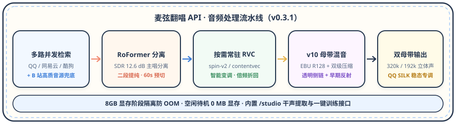

<div align="center">
  

  <br>
  
  <h1>麦弦翻唱 API (MaiChord Cover API)</h1>
  <p>给 MaiBot 麦弦插件配套的本地 AI 翻唱后端，管搜歌、人声分离、RVC 换声、混音和音色训练。</p>

  <p>
    
    
    
    
  </p>

  <p>
    <a href="TRAINING_GUIDE.md">部署与炼丹指南</a>
    &nbsp;·&nbsp;
    <a href="https://github.com/Allure-Gui/feiyu-cover-plugin">配套 MaiBot 插件「麦弦」</a>
    &nbsp;·&nbsp;
    <a href="CHANGELOG.md">更新日志</a>
  </p>
</div>

<p align="center">
  
</p>

<div align="center">
  
</div>

<br>

> [!NOTE]
> 这个仓库是单独跑的 HTTP 后端，主要给 [feiyu-cover-plugin](https://github.com/Allure-Gui/feiyu-cover-plugin) 调用，自己直接发 HTTP 请求也能用。跑起来之后，浏览器打开 `http://127.0.0.1:19655/studio` 可以拖音频提干声，打开 `http://127.0.0.1:19655/models/import-page` 可以直接拖现成的 RVC 模型进来。

<p align="center">
  
</p>

## 主要东西

- **Windows 原生一键包**：不用装 WSL2 也能跑。双击 `一键安装与启动.bat`（Linux / WSL2 跑 `bash install.sh`），脚本会自己查显卡、下便携版 FFmpeg、建三套互不打架的虚拟环境、拉 Applio 和 RoFormer 权重、生成 `config.json` 并启动。中途断网重跑会接着来。
- **人声分离 & 二段提纯**：默认用 `vocals_mel_band_roformer.ckpt`（SDR 12.6 dB），比老 Demucs 干净不少；本地如果放了去和声和去混响模型会自动做二段提纯。60 秒试听和猜歌会先切副歌再分离，15~20 秒出声。
- **RVC 按需加载 & 外部模型导入**：平时空闲显存占用 **0 MB**，来活才拉起，闲置 3 分钟自动卸掉。换声自动读 `.pth` 里的编码器信息，`spin-v2` 和 `contentvec` 模型随便切。兼容无 `.index` 模型，外面 RVC WebUI / Applio 导出的 `.pth` 或 `.zip` 都能直接导进来用。
- **智能变调 & v10 混音**：会按模型的实际训练音域和原唱高音自动算半音，带 RMVPE 倍频飙高音折回保护，伴奏用 `rubberband` 跟着移调。混音按 EBU R128 门控 LUFS 配平，带轻度侧链让位和双级压缩；给 QQ 发语音时切到 `for_qq=1` 的 24kHz 单声道母带，避免 QQ 语音条忽大忽小。
- **干声工坊（`/studio`）**：自带浏览器拖拽上传、RoFormer 提干声、声纹体检（查有效时长、静音占比、削波和 450Hz+ 高音覆盖）、一键无损去静音，以及后台四步训练（最高支持 800 轮）。8GB 显存下分离和训练前会先卸掉 RVC，不容易 OOM。

<p align="center">
  
</p>

## 怎么部署

支持 **Windows 原生**、**Windows WSL2** 和 **Linux**。

### Windows（推荐直接用一键包）
1. 去 [Releases](https://github.com/Allure-Gui/feiyu-cover-api/releases) 下最新压缩包，解压到一个**纯英文路径**（比如 `D:\feiyu-cover-api`）。
2. 双击根目录的 **`一键安装与启动.bat`**，等着它装完就行（默认走清华源，断网可以重开继续）：
   - 自动检测 N 卡（没独显自动切 CPU）；
   - 在 `runtime/` 下建 `service-venv`、`sep-venv`、`rvc-venv` 三套环境；
   - 自动下 Applio 源码、RoFormer 权重，电脑没装 FFmpeg 也会自动下便携版；
   - 自动生成 `config.json`（不会覆盖你改过的配置）并启动服务。
3. 看到控制台打出 `http://127.0.0.1:19655` 就好了：
   - 去 MaiBot 麦弦插件设置里把「API 文件夹路径」填成这个目录，勾上「自动拉起本地服务」，以后就不用手动开了；
   - 浏览器开 `http://127.0.0.1:19655/studio` 拖歌提干声，开 `http://127.0.0.1:19655/models/import-page` 拖现成 `.pth` 模型；
   - 想手动关掉服务就双击 `停止服务.bat`。

### Linux / WSL2
```bash
git clone https://github.com/Allure-Gui/feiyu-cover-api.git
cd feiyu-cover-api
bash install.sh
```
> 常用参数：`bash install.sh --check`（只检查环境）、`--install-only`（只装不启动）、`--no-mirror`（不走清华源）。

<details>
<summary><b>手动装环境 & 跑测试</b></summary>

<br>

- 需要 Python 3.10~3.12、`ffmpeg` / `ffprobe`，以及分开装好的 [Applio](https://github.com/IAHispano/Applio) 和 `audio-separator` 环境（具体命令看 [TRAINING_GUIDE.md](TRAINING_GUIDE.md)）。
- 装 API 服务并启动：
  ```bash
  python3 -m venv .venv
  .venv/bin/pip install -r requirements.txt
  cp config.example.json config.json
  .venv/bin/python -m uvicorn cover_api.app:app --host 0.0.0.0 --port 19655
  ```
- 无 GPU 冒烟测试（20 项）：
  ```bash
  PYTHONPATH=. .venv/bin/python cover_api/test_smoke.py
  ```

</details>

<p align="center">
  
</p>

## 配置与 HTTP 接口

<details>
<summary><b>config.json 常用字段（完整样例见 config.example.json）</b></summary>

<br>

- **`rvc`**：`python` / `cwd`（Applio 目录）、`model` / `index`（默认权重和索引）、`models_dir`（扫模型的目录）、`index_rate`（RefineGAN 建议 `0.50~0.65`，HiFi-GAN 建议 `0.25~0.35`）、`protect=0.45`、`volume_envelope=0.25`、`use_worker=true`、`idle_unload_seconds=180`、`auto_pitch=true`、`trim_silence=true`。
- **`separate`**：`python`、`model="vocals_mel_band_roformer.ckpt"`、`model_dir`、`overlap=2`、`batch_size=2`（显存不够会自动降到 `1`）。
- **`mix`**：`vocal_target_db=-12.0`、`inst_target_db=-15.5`、`inst_vocal_pocket_db=-1.5`、`vocal_reverb_mix=0.05`、`voice_sample_rate=44100`、`voice_channels=2`、`voice_bitrate="192k"`。
- **`source`**：`order=["bilibili","gd","txqq","qq"]`、`bili_enabled=true`、`bili_fallback=true`、`meting_enabled=true`。

</details>

<details>
<summary><b>HTTP 接口清单与示例</b></summary>

<br>

| 方法 | 路径 | 用途 |
|---|---|---|
| `GET` | `/health` | 健康检查与版本 |
| `GET` | `/capabilities` | 环境自检 |
| `GET` | `/models` | 列出所有可用模型（兼容无 `.index` 和外部导入模型） |
| `POST` | `/models/import` | 从本机路径导入 `.pth` / `.zip` / 文件夹（自动配对 `.index`） |
| `POST` | `/models/upload` | 接收浏览器上传的模型文件 |
| `GET` | `/models/import-page` | 浏览器拖拽导入模型页面 |
| `GET` | `/sources/search` | 多平台并发搜歌 |
| `POST` | `/cover` | 提交翻唱任务 |
| `GET` | `/jobs` / `/jobs/{id}` | 查任务列表和单任务进度 |
| `POST` | `/jobs/{id}/cancel` | 取消任务 |
| `GET` | `/jobs/{id}/audio` | 下载完整 320k MP3 |
| `GET` | `/jobs/{id}/voice-info` / `/voice-part/{i}` | 分段语音条（`for_qq=1` 走 QQ 专调） |
| `GET` | `/jobs/{id}/highlight` | 58 秒副歌直出（`vocals_only=1` 出 15 秒清唱，`for_qq=1` 走 QQ 专调） |
| `GET` | `/studio` | 干声工坊浏览器上传页 |
| `GET` | `/studio/status` | 工坊进度、日志和素材库 |
| `POST` | `/studio/inspect` | 干声素材声纹体检 |
| `POST` | `/studio/clean` | 无损去静音（写到 `<名称>-clean`，不动原文件） |
| `POST` | `/studio/upload` | 接收上传的音频 |
| `POST` | `/studio/separate` | 后台 RoFormer 提干声 |
| `POST` | `/studio/train` | 后台 RVC 四步训练（`epochs` 支持 20~800） |
| `POST` | `/studio/cancel` | 停止工坊任务 |
| `GET` | `/system/status` / `POST /system/unload` | 看显存与 RVC 状态 / 手动释放显存 |
| `GET` | `/cache/stats` / `POST /cache/clean` / `config` | 缓存统计、清理和阈值设置 |

```bash
# 试跑一个 60 秒极速试听
curl -X POST http://127.0.0.1:19655/cover \
  -H "Content-Type: application/json" \
  -d '{"song":"起风了","preview_seconds":60,"voice":{"auto_pitch":true,"index_rate":0.55}}'
```

</details>

<details>
<summary><b>开源组件与版权说明</b></summary>

<br>

本仓库**不包含任何音频素材或模型权重**，只负责把下面这些开源项目串起来用：
[FastAPI](https://github.com/fastapi/fastapi) · [Uvicorn](https://github.com/encode/uvicorn) · [httpx](https://github.com/encode/httpx) · [Pydantic](https://github.com/pydantic/pydantic) · [Applio](https://github.com/IAHispano/Applio) · [python-audio-separator](https://github.com/nomadkaraoke/python-audio-separator) · [Demucs](https://github.com/facebookresearch/demucs) · [FFmpeg](https://ffmpeg.org/)。请自行遵守训练素材和翻唱作品的相关版权规定。

横幅和图标基于 MaiBot 官方形象绘制，仅用于本开源项目。

</details>

<p align="center">
  
  <sub>MIT License — 详见 <a href="LICENSE">LICENSE</a></sub>
</p>
